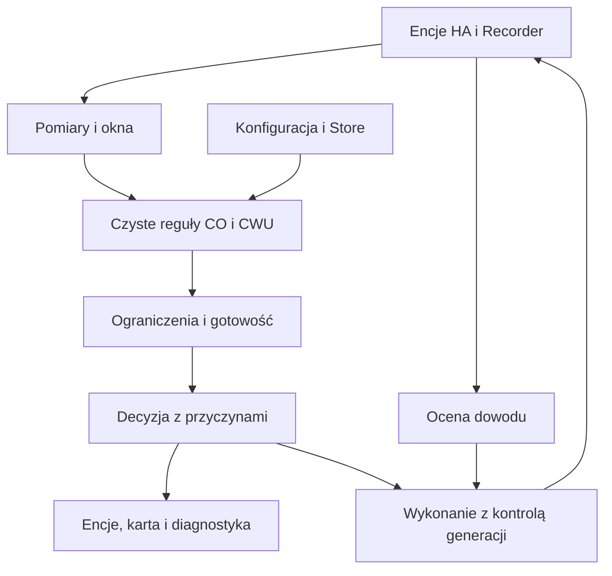

# Architektura

Podstawa: D03, D06, D17–D20, D45, D68–D89; US01–US20.
Opisane rozwiązania T01–T08 są propozycją techniczną do przeglądu.
Lista pytań produktowych: [P01–P12](open-decisions.md).

## Granice

T01: jedna custom integration `heat_pump_steering`, jeden ConfigEntry na pompę.
Osobny stan CO i CWU w `entry.runtime_data`. Zależności:
HA i biblioteka standardowa w runtime; brak klienta Hisense, chmury, DB i brokera
produktu. Nie ma frameworka modułów ani agentów w działającym regulatorze.
Dwa jawne wywołania funkcji korekt wystarczą dla US20.
Nie sterujemy sprężarką, defrostem, zabezpieczeniami i pompami obiegowymi.

## Moduły i kontrakty

| Moduł przyszłego kodu | Wejście → wynik | Własność / awaria |
| --- | --- | --- |
| config_flow, config | UI → zwalidowana konfiguracja i rezerwacje wyjść | Bez usług urządzeń; konflikt odrzuca cały zapis |
| models | Typowane rekordy → niemutowalne snapshoty | Brak czasu systemowego i HA |
| measurements, history | Raporty + historia → szeregi, jakość, okna | Brak wartości nie daje zera; historia nie dowodzi wykonania |
| zones | Pomiar, cel, pamięć, czas → żądanie strefy i timery | Ochrona spadku, minimum zamknięcia, awaryjne otwarcie |
| co | Outdoor, kwalifikowane strefy → baza, komfort, trend | Brak trendu wyłącza tylko tę korektę |
| constraints | Kandydat + limity + pamięć → propozycja wykonywalna lub blokada | Zawsze obowiązuje, również z wyłączonymi korektami |
| demand | Aktualne żądania + potwierdzenia przekaźników → ON/OFF | OR; niepotwierdzone otwarcie nie wystarczy; brak wyjścia tylko diagnostyka |
| dhw | Zapisany plan + nadpisanie + lokalny czas → żądanie CWU | Osobne zależności; ON po temperaturze, OFF niezależnie |
| commands | Aktualne żądanie + dowód + retry → pojedyncze wywołanie HA | Jedyny moduł wywołujący usługi urządzeń |
| runtime | Zdarzenia, deadline, rewizje → uporządkowana ocena | Odłącza subskrypcje i unieważnia stare działania |
| persistence | Zwalidowany stan → Store i odbudowa | Nieudany trwały zapis nie zostaje zgłoszony jako sukces |
| sensor, number, switch, event, diagnostics | Snapshot → standardowe encje i eksport | Właściwości bez I/O; eksport usuwa dane własne |
| websocket_api, frontend | Użytkownik → transakcje nastaw i widoki | Frontend nie steruje bezpośrednio źródłowym przekaźnikiem |

Nie narzucamy DataUpdateCoordinator do odczytów zdarzeniowych cudzych encji.
Własne listenery wybranych encji, dispatcher aktualizacji widoków i jeden
runtime per entry wystarczą. Odczyt historii odbywa się przez API Recordera
w executorze, bez własnego SQL.

## Czysta ścieżka decyzji

`evaluate(snapshot, persisted_state, now) -> Evaluation`: zawiera nowe stany logiczne,
propozycje, gotowość, przyczyny, najbliższe terminy; nie wykonuje zapisów.
`now` oraz dane są argumentami. Efekty wykonuje runtime po ponownej walidacji.

CO: agregacja termometrów przed oknami; lokalne reguły stref przed wyborem
kwalifikowanych stref komfortu. Zamknięcie wymaga raportu i czasu ruchu;
nieudane zamknięcie nie wyłącza ochrony. Komfort: ważone błędy, martwa strefa
i limit osobno. Trend porównuje temperatury dla tego samego zestawu stref
teraz i 12 h wcześniej, nie błędy zależne od celu. Brak wspólnej historii
nie tworzy trendu zerowego z fikcyjnych próbek.

Wynik: baza → aktywne korekty → limit sumy → zakres PC/zawężenie użytkownika →
ochrona wzrostu → ograniczenie nowego kroku i czasu → końcowa kwantyzacja
na dozwolonej siatce. Dobór wartości musi spełniać wszystkie limity jednocześnie.
Jeśli siatka nie zawiera dopuszczalnego kroku, blokada, nie zaokrąglenie poza limit.
Niepotwierdzona nastawa nie jest bazą kolejnego kroku.
Przypadki mieszane bez kwalifikowanej strefy i zmiana limitów: P09/P10.

Obserwacja używa tej samej oceny, ale wykonawca niczego nie wysyła.
Nie tworzy kolejki do późniejszej aktywacji. Wyłączenie funkcji nie produkuje OFF.
Awaryjne otwarcie D48 jest decyzją aktywnego modułu, nigdy efektem unload.
Odczyt CO1 i CWU wymagany także w obserwacji zgodnie z D69.

## Izolacja

Błąd optionalnego licznika nie blokuje regulatora; brak outdoor blokuje nastawę CO,
nie sprawne zawory/demand ani CWU. Uszkodzony Store wspólnych danych blokuje
wykonanie, bo nie można wiarygodnie odtworzyć trybów i timerów.
Konfiguracja innej pompy nie przejmuje wyjść. Blokada właścicieli obejmuje wszystkie
wpisy produktu, również wyłączone, które zachowują przypisania.
Nie wykrywamy ani nie wyłączamy cudzych automatyzacji; aktywacja pokazuje ostrzeżenie.
